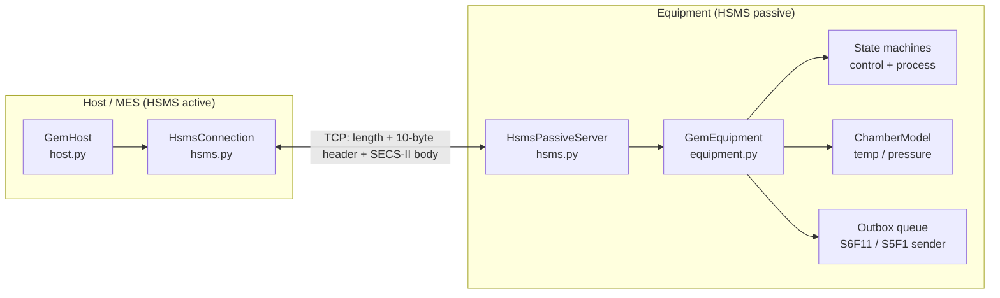

# secsgem-simulator

A from-scratch **SECS/GEM equipment simulator** and **host (MES) client** in pure Python
(standard library only, `asyncio`). It implements the three protocol layers a fab
automation engineer works with every day, without any third-party SECS library:

| Layer | Standard | Module |
|---|---|---|
| Data items: binary encoding + SML text | SEMI E5 (SECS-II) | `secsgem_sim/secs2.py` |
| Transport over TCP/IP | SEMI E37 (HSMS) | `secsgem_sim/hsms.py` |
| Equipment behaviour (state models, events, alarms, remote commands) | SEMI E30 (GEM), subset | `secsgem_sim/equipment.py` |

The simulated tool is a single-chamber **etch tool** whose temperature and pressure drift
over time while a recipe runs. If the temperature passes a limit it raises an alarm, and
the demo host reacts by aborting the run.

## What are SECS, GEM and HSMS? (plain English)

- **SECS-II (SEMI E5)** is the *message format*. Every message is identified by a
  **stream** and **function**, e.g. `S1F13` = Stream 1, Function 13 ("Establish
  Communications Request"). Odd functions are requests, even functions are replies.
  The body is one data item: a nested list of typed values (ASCII, integers, floats ...)
  encoded in a compact binary format.
- **HSMS (SEMI E37)** is the *transport*. It carries SECS-II messages over TCP/IP: a
  4-byte length, a 10-byte header (who, which message, transaction id), then the body.
  It also defines control messages to open a session (Select), check the link
  (Linktest) and close it (Separate).
- **GEM (SEMI E30)** is the *behaviour standard*. It says what every tool must do so
  that one factory host can drive many tool types the same way: report status, accept
  remote commands only when allowed, send event reports and alarms the host asked for,
  follow standard state models (communication, control, ...).

## Architecture



```
 Host process                                    Equipment process
 ------------                                    -----------------
 demo.py / your code                             GemEquipment
   |  await host.remote_command("START")           | handlers: (stream, function) -> method
 GemHost  (host.py)                                | state machines, sensor loop, alarms
   |  SecsMessage(2, 41, W, body)                  | emit_event() -> outbox -> S6F11
 HsmsConnection  (hsms.py)  <=== TCP/IP ===>     HsmsConnection (hsms.py)
   |  system-bytes -> Future map                   |  read loop, T7, linktest
 secs2.encode / decode                           secs2.encode / decode
```

Each layer only knows about the one below it: `secs2` knows nothing about sockets,
`hsms` knows nothing about GEM, and `equipment`/`host` never touch bytes.

## Supported messages

Equipment-side handling (what the simulated tool understands or sends):

| Message | Direction | Meaning | Notes |
|---|---|---|---|
| S1F1 / F2 | H→E | Are You There / On Line Data | returns MDLN, SOFTREV |
| S1F3 / F4 | H→E | Selected Equipment Status | empty list = all SVIDs; unknown SVID → empty item |
| S1F11 / F12 | H→E | Status Variable Namelist | SVID, name, units |
| S1F13 / F14 | H→E | Establish Communications | COMMACK; required before anything else |
| S1F15 / F16 | H→E | Request OFF-LINE | OFLACK |
| S1F17 / F18 | H→E | Request ON-LINE | ONLACK 0/2; LOCAL vs REMOTE comes from the operator switch |
| S2F13 / F14 | H→E | Equipment Constant Request | |
| S2F15 / F16 | H→E | New Equipment Constant Send | EAC; range-checked, all-or-nothing |
| S2F33 / F34 | H→E | Define Report | DRACK 0-4; empty list deletes all |
| S2F35 / F36 | H→E | Link Event Report | LRACK 0-5 |
| S2F37 / F38 | H→E | Enable/Disable Event Report | ERACK; empty list = all CEIDs |
| S2F41 / F42 | H→E | Host Command Send | RCMD: PP-SELECT, START, STOP, PAUSE, RESUME, ABORT; HCACK + CPACK |
| S5F1 / F2 | E→H | Alarm Report | ALCD bit 8 = set/cleared, low bits = category |
| S5F3 / F4 | H→E | Enable/Disable Alarm | zero-length ALID = all |
| S5F5 / F6 | H→E | List Alarms | |
| S6F11 / F12 | E→H | Event Report Send | values captured at the moment of the event |
| S9F1 | E→H | Unrecognized Device ID | |
| S9F3 | E→H | Unrecognized Stream | |
| S9F5 | E→H | Unrecognized Function | |
| S9F7 | E→H | Illegal Data | bad body structure or undecodable bytes |
| S9F9 | E→H | Transaction Timer Timeout | sent when the host does not answer S6F11/S5F1 within T3 |
| SxF0 | E→H | Abort Transaction | used when not communicating / OFFLINE |

HSMS control messages: Select.req/rsp, Deselect.req/rsp, Linktest.req/rsp, Separate.req,
Reject.req (reasons 1-4).

### Equipment data model

| Kind | IDs |
|---|---|
| SVIDs | 1001 ChamberTemp (F4 degC), 1002 ChamberPressure (F4 mTorr), 1003 WaferCount (U4), 1004 ProcessState (A), 1005 ControlState (U1, E30 values 3/4/5), 1006 Clock (A16) |
| DVIDs | 4001 PPID (A), 4002 CurrentWafer (U4) |
| ECIDs | 2001 TempSetpoint (60, 20-120), 2002 PressureSetpoint (50, 1-300), 2003 OverTempLimit (80, 30-150), 2004 WaferProcessTime (1.0 s, 0.1-60) |
| CEIDs | 3001 ProcessStarted, 3002 ProcessCompleted, 3003 WaferCompleted, 3004 ProcessAborted, 3005 ProcessPaused, 3006 ProcessResumed, 3007 ProcessStopped |
| ALIDs | 1 ChamberOverTemp (equipment safety), 2 ChamberPressureHigh (parameter control warning) |
| Recipes | ETCH_OXIDE_01 (3 wafers), ETCH_POLY_02 (5 wafers) |

### State models

```
Control state (simplified E30)

    OFFLINE --S1F17, operator switch = REMOTE--> ONLINE/REMOTE
    OFFLINE --S1F17, operator switch = LOCAL---> ONLINE/LOCAL
    ONLINE/LOCAL  <--operator turns the switch--> ONLINE/REMOTE
    ONLINE/LOCAL or ONLINE/REMOTE --S1F15-->      OFFLINE

Process state

    IDLE --PP-SELECT or START(PPID)--> SETUP --setup done--> READY --START--> EXECUTING
    EXECUTING --PAUSE--> PAUSED --RESUME--> EXECUTING
    EXECUTING --last wafer done (or STOP after current wafer)--> IDLE
    SETUP / READY / EXECUTING / PAUSED --ABORT--> IDLE
```

Remote commands are only accepted in ONLINE/REMOTE (otherwise HCACK 2). Only the
operator at the tool can switch between LOCAL and REMOTE.

## Quickstart

Requires Python 3.9+. No runtime dependencies.

```bash
git clone <your-fork-url> secsgem-simulator && cd secsgem-simulator
python3 -m venv .venv && source .venv/bin/activate
pip install pytest            # only needed for the tests

# terminal 1: the simulated tool (HSMS passive, listens on port 5000)
python -m secsgem_sim equipment --port 5000

# terminal 2: the host, running the scripted end-to-end scenario
python -m secsgem_sim host --port 5000 --demo
```

Useful options: `--local` (equipment starts with the operator switch in LOCAL, so remote
commands are refused), `--log-format json` (one JSON object per line with `sxfy`,
`direction`, `system_bytes` fields), `--no-trace` (hide per-message SML),
`--t3/--t6/--t7/--linktest` (timers). `python -m secsgem_sim host --port 5000` without
`--demo` connects, goes online, enables all events/alarms and prints whatever arrives.

Using the host API from your own code:

```python
import asyncio
from secsgem_sim.host import GemHost

async def main():
    host = GemHost("127.0.0.1", 5000)
    await host.connect()                     # TCP + HSMS Select
    await host.establish_communications()    # S1F13
    await host.request_online()              # S1F17
    await host.enable_events()               # S2F37, all CEIDs
    done = host.expect_event(3002)           # register BEFORE triggering
    result = await host.remote_command("START", {"PPID": "ETCH_OXIDE_01"})
    print(result.hcack.name)                 # ACK_FINISH_LATER
    print(await asyncio.wait_for(done, 30))  # EventReport(dataid=..., ceid=3002, ...)
    await host.close()                       # Separate.req

asyncio.run(main())
```

## Sample demo output

Real output from `python -m secsgem_sim host --port 5000 --demo` (excerpt; the full run is
in [`docs/demo_output.txt`](docs/demo_output.txt)). `-->` is sent by the host, `<--` is
received. Note the system bytes: the reply always carries the request's value, and the
equipment numbers its own S6F11/S5F1 transactions independently.

```
09:07:02.485 INFO    demo       ============ 1. Connect: TCP + HSMS Select ============
09:07:02.485 INFO    hsms       [host] TCP connected to 127.0.0.1:5000 -> CONNECTED/NOT SELECTED
09:07:02.485 INFO    trace      [host] --> Select.req  (sys=0x00000001)
09:07:02.486 INFO    trace      [host] <-- Select.rsp status=0  (sys=0x00000001)
09:07:02.486 INFO    hsms       [host] HSMS state CONNECTED/NOT SELECTED -> CONNECTED/SELECTED
09:07:02.486 INFO    demo       ============ 2. Establish communications (S1F13) ============
09:07:02.486 INFO    trace      [host] --> S1F13 W  (sys=0x00000002)
    <L [0]>
09:07:02.487 INFO    trace      [host] <-- S1F14  (sys=0x00000002)
    <L [2] <B 0x00> <L [2] <A "ETCH-SIM-200"> <A "0.1.0">>>
09:07:02.487 INFO    demo       COMMACK = 0
09:07:02.487 INFO    demo       ============ 3. Request ONLINE (S1F17), then Are You There (S1F1) ============
09:07:02.487 INFO    trace      [host] --> S1F17 W  (sys=0x00000003)
09:07:02.487 INFO    trace      [host] <-- S1F18  (sys=0x00000003)
    <B 0x00>
09:07:02.487 INFO    demo       ONLACK = 0
09:07:02.487 INFO    trace      [host] --> S1F1 W  (sys=0x00000004)
09:07:02.488 INFO    trace      [host] <-- S1F2  (sys=0x00000004)
    <L [2] <A "ETCH-SIM-200"> <A "0.1.0">>
09:07:02.488 INFO    demo       tool model ETCH-SIM-200, software 0.1.0
    ... (steps 4-8: status variables, constants, report setup, alarm setup, a rejected RESUME) ...
09:07:02.494 INFO    demo       ============ 9. Run recipe ETCH_OXIDE_01 with a PAUSE/RESUME in the middle ============
09:07:02.494 INFO    trace      [host] --> S2F41 W  (sys=0x0000000F)
    <L [2] <A "START"> <L [1] <L [2] <A "PPID"> <A "ETCH_OXIDE_01">>>>
09:07:02.494 INFO    trace      [host] <-- S2F42  (sys=0x0000000F)
    <L [2] <B 0x04> <L [0]>>
09:07:02.494 INFO    demo       HCACK = 4 (ACK_FINISH_LATER)
09:07:02.796 INFO    trace      [host] <-- S6F11 W  (sys=0x00000001)
    <L [3]
      <U4 1>
      <U4 3001>
      <L [1] <L [2] <U4 100> <L [2] <A "EXECUTING"> <A "ETCH_OXIDE_01">>>>
    >
09:07:02.796 INFO    demo       EVENT  ProcessStarted (CEID 3001)  RPT 100: ProcessState=EXECUTING, PPID=ETCH_OXIDE_01
09:07:02.796 INFO    trace      [host] --> S6F12  (sys=0x00000001)
    <B 0x00>
09:07:03.400 INFO    trace      [host] <-- S6F11 W  (sys=0x00000002)
    <L [3]
      <U4 2>
      <U4 3003>
      <L [1]
        <L [2] <U4 101> <L [4] <U4 1> <U4 1> <F4 38.2154> <F4 36.11283>>>
      >
    >
09:07:03.400 INFO    demo       EVENT  WaferCompleted (CEID 3003)  RPT 101: CurrentWafer=1, WaferCount=1, ChamberTemp=38.2, ChamberPressure=36.1
09:07:03.400 INFO    trace      [host] --> S6F12  (sys=0x00000002)
    <B 0x00>
    ... (pause/resume and wafers 2-3, ProcessCompleted) ...
09:07:04.911 INFO    demo       ============ 10. Over-temperature: bad setpoint, alarm, host ABORTs ============
09:07:04.911 INFO    trace      [host] --> S2F15 W  (sys=0x00000013)
    <L [1] <L [2] <U4 2001> <F4 95>>>
09:07:04.912 INFO    trace      [host] <-- S2F16  (sys=0x00000013)
    <B 0x00>
09:07:04.912 INFO    trace      [host] --> S2F41 W  (sys=0x00000014)
    <L [2] <A "START"> <L [1] <L [2] <A "PPID"> <A "ETCH_POLY_02">>>>
09:07:04.913 INFO    trace      [host] <-- S2F42  (sys=0x00000014)
    <L [2] <B 0x04> <L [0]>>
09:07:05.215 INFO    trace      [host] <-- S6F11 W  (sys=0x00000008)
    <L [3]
      <U4 8>
      <U4 3001>
      <L [1] <L [2] <U4 100> <L [2] <A "EXECUTING"> <A "ETCH_POLY_02">>>>
    >
09:07:05.215 INFO    demo       EVENT  ProcessStarted (CEID 3001)  RPT 100: ProcessState=EXECUTING, PPID=ETCH_POLY_02
09:07:05.215 INFO    trace      [host] --> S6F12  (sys=0x00000008)
    <B 0x00>
09:07:05.817 INFO    trace      [host] <-- S6F11 W  (sys=0x00000009)
    <L [3]
      <U4 9>
      <U4 3003>
      <L [1]
        <L [2] <U4 101> <L [4] <U4 1> <U4 4> <F4 67.98984> <F4 44.96368>>>
      >
    >
09:07:05.817 INFO    demo       EVENT  WaferCompleted (CEID 3003)  RPT 101: CurrentWafer=1, WaferCount=4, ChamberTemp=68.0, ChamberPressure=45.0
09:07:05.817 INFO    trace      [host] --> S6F12  (sys=0x00000009)
    <B 0x00>
09:07:06.420 INFO    trace      [host] <-- S6F11 W  (sys=0x0000000A)
    <L [3]
      <U4 10>
      <U4 3003>
      <L [1]
        <L [2] <U4 101> <L [4] <U4 2> <U4 5> <F4 78.57616> <F4 48.01049>>>
      >
    >
09:07:06.420 INFO    demo       EVENT  WaferCompleted (CEID 3003)  RPT 101: CurrentWafer=2, WaferCount=5, ChamberTemp=78.6, ChamberPressure=48.0
09:07:06.420 INFO    trace      [host] --> S6F12  (sys=0x0000000A)
    <B 0x00>
09:07:06.500 INFO    trace      [host] <-- S5F1 W  (sys=0x0000000B)
    <L [3] <B 0x82> <U4 1> <A "Chamber temperature above OverTempLimit">>
09:07:06.500 WARNING demo       ALARM  ALID 1 SET: Chamber temperature above OverTempLimit
09:07:06.500 INFO    trace      [host] --> S5F2  (sys=0x0000000B)
    <B 0x00>
09:07:06.500 INFO    demo       host policy: over-temp alarm -> ABORT
09:07:06.500 INFO    trace      [host] --> S2F41 W  (sys=0x00000015)
    <L [2] <A "ABORT"> <L [0]>>
09:07:06.501 INFO    trace      [host] <-- S2F42  (sys=0x00000015)
    <L [2] <B 0x00> <L [0]>>
09:07:06.501 INFO    demo       HCACK = 0 (OK)
09:07:06.501 INFO    trace      [host] <-- S6F11 W  (sys=0x0000000C)
    <L [3]
      <U4 11>
      <U4 3004>
      <L [2]
        <L [2] <U4 100> <L [2] <A "IDLE"> <A "ETCH_POLY_02">>>
        <L [2] <U4 101> <L [4] <U4 3> <U4 5> <F4 80.93714> <F4 48.20033>>>
      >
    >
09:07:06.501 INFO    demo       EVENT  ProcessAborted (CEID 3004)  RPT 100: ProcessState=IDLE, PPID=ETCH_POLY_02 | RPT 101: CurrentWafer=3, WaferCount=5, ChamberTemp=80.9, ChamberPressure=48.2
09:07:06.501 INFO    trace      [host] --> S6F12  (sys=0x0000000C)
    <B 0x00>
09:07:06.701 INFO    trace      [host] <-- S5F1 W  (sys=0x0000000D)
    <L [3] <B 0x02> <U4 1> <A "Chamber temperature above OverTempLimit">>
09:07:06.701 WARNING demo       ALARM  ALID 1 CLEARED: Chamber temperature above OverTempLimit
09:07:06.701 INFO    trace      [host] --> S5F2  (sys=0x0000000D)
    <B 0x00>
09:07:06.702 INFO    trace      [host] --> S2F15 W  (sys=0x00000016)
    <L [1] <L [2] <U4 2001> <F4 60>>>
09:07:06.702 INFO    trace      [host] <-- S2F16  (sys=0x00000016)
    <B 0x00>
09:07:06.703 INFO    demo       ============ 11. Unknown message S1F99 -> equipment answers S9F5 ============
09:07:06.703 INFO    trace      [host] --> S1F99 W  (sys=0x00000017)
09:07:06.703 INFO    trace      [host] <-- S9F5  (sys=0x0000000E)
    <B 0x00 0x00 0x81 0x63 0x00 0x00 0x00 0x00 0x00 0x17>
09:07:06.703 WARNING host       equipment reported S9F5 (Unrecognized Function Type)
09:07:06.703 INFO    demo       got S9F5: Unrecognized Function Type
09:07:06.703 INFO    demo       ============ 12. Linktest, go OFFLINE (S1F15), Separate ============
09:07:06.703 INFO    trace      [host] --> Linktest.req  (sys=0x00000018)
09:07:06.704 INFO    trace      [host] <-- Linktest.rsp  (sys=0x00000018)
09:07:06.704 INFO    demo       linktest round trip 0.6 ms
09:07:06.704 INFO    trace      [host] --> S1F15 W  (sys=0x00000019)
09:07:06.705 INFO    trace      [host] <-- S1F16  (sys=0x00000019)
    <B 0x00>
09:07:06.705 INFO    demo       OFLACK = 0
09:07:06.705 INFO    trace      [host] --> Separate.req  (sys=0x0000001A)
09:07:06.705 INFO    hsms       [host] closing connection: sent Separate.req
09:07:06.705 INFO    hsms       [host] HSMS state CONNECTED/SELECTED -> NOT CONNECTED
09:07:06.705 INFO    demo       done: 39 HSMS messages sent, 38 received, 11 event reports, 2 alarm reports
```

## Tests

```bash
.venv/bin/pytest            # or: python -m pytest
```

```
112 passed in 10.10s
```

| File | Tests | What it covers |
|---|---|---|
| `tests/test_secs2.py` | 57 | exact wire bytes, round trips for all 14 formats, nested lists, length boundaries 255/256 and 65535/65536 (1/2/3 length bytes), encode/decode error cases, SML output |
| `tests/test_hsms.py` | 16 | header layout, framing, select, concurrent request/reply matching by system bytes, linktest, Reject.req when not selected, T3, T6, T7, separate, second-connection refusal |
| `tests/test_state_machines.py` | 10 | valid/invalid process and control transitions, sensor model convergence |
| `tests/test_integration.py` | 27 | real equipment + host on an ephemeral localhost port: select → S1F13 → online → START → S6F11 → linktest; rejections (LOCAL, OFFLINE, before S1F13, wrong state, bad params); PAUSE/RESUME/ABORT/STOP; EC validation; report setup errors; alarm set/clear; S9F1/F3/F5/F7/F9 |
| `tests/test_cli.py` | 2 | CLI parsing, the whole demo scenario run in-process |

Async tests run through a ten-line hook in `tests/conftest.py` (no pytest-asyncio needed),
each with a hard 20 s timeout.

## Design notes

**Why asyncio.** An equipment connection has several things going on at once: the
socket read loop, the linktest heartbeat, the T7 timer, the sensor simulation, a
running recipe, and outgoing event reports waiting for their acknowledgements. With
asyncio each of these is a small coroutine on one thread, so there are no locks around
shared state such as the state machines. A state change is never interrupted halfway,
because a coroutine only gives up control at an `await`. It also maps naturally onto
the protocol: "send and wait up to T3 for the reply" is
`await asyncio.wait_for(future, t3)`.

**Transaction matching by system bytes.** Every request gets a fresh 4-byte system
bytes value. Before sending a W-bit message the connection stores an `asyncio.Future`
in a dict keyed by that value. The read loop looks up each incoming reply (even
function, or F0) by its system bytes and completes that future. This lets several
requests be in flight at once (tested with concurrent requests) and makes T3 a simple
timeout on the future. Control transactions (Select/Linktest) use a separate dict so a
data reply can never complete a control transaction by accident. S9Fx messages contain
the header of the offending message, so the host uses the system bytes inside them to
fail the right transaction immediately instead of waiting for T3.

**Primary messages are handled in their own task.** The read loop never waits on
application code. If a handler is slow, or itself sends a request and waits for the
reply, the socket keeps being read, so no deadlock is possible.

**State machines as tables.** Control and process states are `(state, trigger) ->
next_state` dicts (`state_machines.py`). The equipment code calls
`process.fire("start")`, and an invalid move raises instead of silently corrupting
state. Transitions caused by a remote command happen synchronously inside the handler,
before the reply is sent. So if the host sends START twice back-to-back, the second
one already sees EXECUTING and is rejected; it cannot start a second run.

**Values captured at event time.** `emit_event()` builds the S6F11 body immediately,
then queues it. A single sender task sends queued reports one at a time, in order,
waiting for each S6F12. The report shows the temperature at the moment the wafer
finished, not when the message happened to go out.

**Select race avoided.** The passive side moves to SELECTED *before* sending
Select.rsp. The active side changes state inside the read loop when the Select.rsp
arrives. Either way, a data message sent right behind the Select.rsp is never wrongly
rejected as "not selected".

**Validate, then apply.** S2F15, S2F33, S2F35 and S2F37 check every entry before
changing anything, so a request with one bad entry changes nothing. This matches the
"at least one ... invalid" wording of the ack codes.

## Simplifications vs. the SEMI standards

This is a learning and portfolio project, not a certified GEM implementation. The
known gaps:

- **E30 subset.** No spooling, trace data collection (S2F23/S6F1), process program
  management (S7), terminal services (S10), limits monitoring, clock setting (S2F31),
  or EC/CE namelists (S2F29, S1F23). Alarms are not linked to alarm-set/alarm-cleared
  collection events, which full E30 compliance expects.
- **Control state.** The OFFLINE substates (EQUIPMENT OFFLINE / ATTEMPT ONLINE / HOST
  OFFLINE) are collapsed into one OFFLINE state. The CONTROLSTATE SV reports 3/4/5.
- **Communication state.** Only the host initiates S1F13, and there is no
  CommDelay/retry timer. While NOT COMMUNICATING, the simulator answers other W-bit
  primaries with SxF0 so the refusal shows up in traces; E30 only requires that they
  are not processed.
- **HSMS.** HSMS-SS only (one session, one connection), not HSMS-GS. T8 is enforced as
  a deadline for the whole message once its length has been read, not per gap between
  bytes. T5 is used between active connect attempts, with no automatic reconnect after
  a drop.
- **SECS-II.** Formats J (JIS-8), C2 (2-byte characters) and the multi-byte Unicode
  format are not implemented. ASCII is strict 7-bit.
- **S9.** S9F11 (data too long) and S9F13 (conversation timeout) are not generated.
- **Recipes** are a fixed table, not downloadable process programs.

## License

MIT, see [LICENSE](LICENSE).
